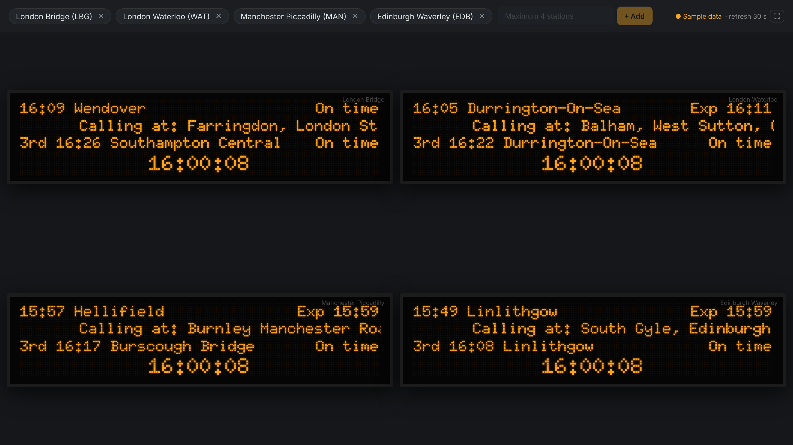
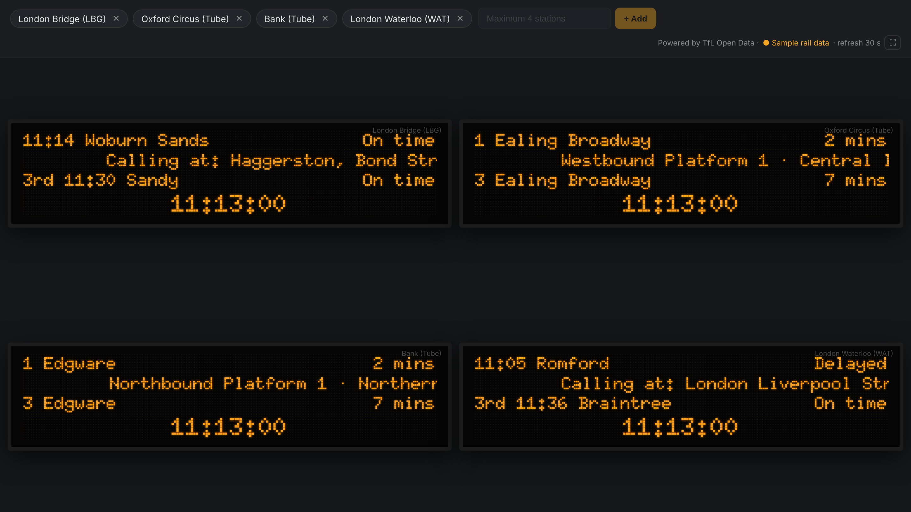
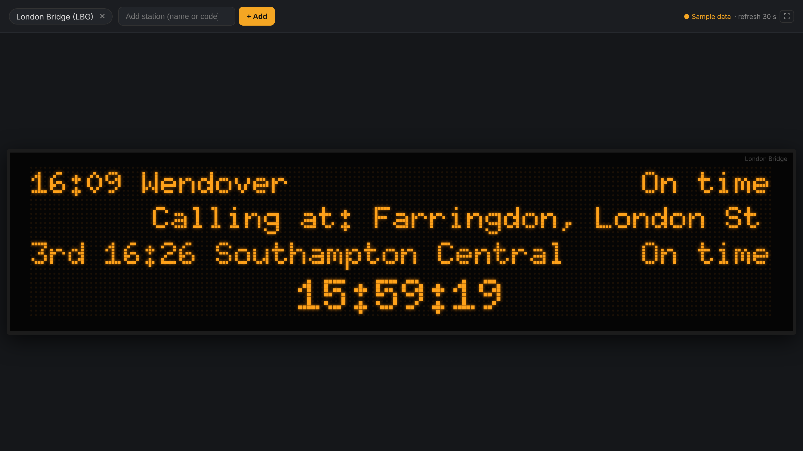
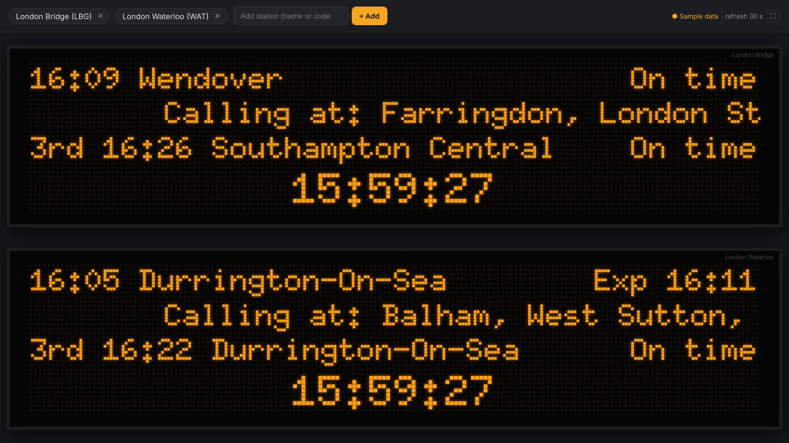

# UK Platform Departure Board

A web page that looks like the orange dot-matrix departure boards on UK railway platforms. Type a station, and its next trains appear. You can show **up to 4 stations** at once, mixing **National Rail** and **London Underground** stations.



## What it shows

Each board has four lines, like the real ones:

1. **Next train:** time, destination and status (`On time`, `Exp 14:44`, `Delayed`, `Cancelled`).
2. **Calling at:** the stops, scrolling right to left.
3. **Following trains:** `2nd`, `3rd`, `4th`… taking turns every 4 seconds.
4. **Clock:** UK time (HH:MM:SS).

Data refreshes every 30 seconds.

### Tube boards

London Underground stations get a Tube-style board, like the ones on the platforms:

1. **Next train:** `1 Brixton` with minutes to go (`2 mins`, `Due`).
2. **Platform and line status**, scrolling, e.g. `Southbound Platform 4 · Victoria line: Good Service.`
3. **Following trains:** `2 …`, `3 …` taking turns.
4. **Clock.**

Stations with several platforms rotate through them every 12 seconds. Minutes count down between refreshes.



## Layouts

| Stations | Layout |
|---|---|
| 1 | One large board |
| 2 | Two boards, one above the other |
| 3–4 | Screen split in 4 |

| 1 station | 2 stations |
|---|---|
|  |  |

## Using it

- **Add a station:** type its name or 3-letter code (e.g. `Bath Spa` or `BTH`) and press **+ Add**. Suggestions appear as you type. Tube stations are listed as e.g. `Oxford Circus (Tube)`; typing `Bank tube` also works.
- **Remove a station:** click **✕** on its tag.
- **Bookmark a set:** the web address keeps your stations, e.g. `http://localhost:3000/?stations=LBG,WAT,MAN,EDB`. Your last set is also remembered in the browser.
- **Full screen:** the **⛶** button hides the toolbar (handy on a spare monitor or TV). Press `Esc` to leave.

## Running it

You need [Node.js](https://nodejs.org) 18 or newer. Running it locally needs nothing installed.

```bash
npm start
```

Then open http://localhost:3000.

Without an API key it runs on **sample data** (made-up trains that look realistic). The toolbar shows `● Sample data` or `● Live data`.

## Live data (API key, local)

Live times come from the **Rail Data Marketplace** (the official National Rail source).

1. Create a free account at [raildata.org.uk](https://raildata.org.uk/).
2. Search the catalogue for **Live Departure Board** and subscribe. Approval can take from minutes to a few days.
3. In the product's **Specification** tab, copy the **Consumer key**.
4. Copy `.env.example` to `.env` and paste the key:

   ```
   RDM_API_KEY=your-consumer-key
   ```

5. Restart with `npm start`.

The key stays on the server. It is never sent to the browser, and `.env` is excluded from git.

If your subscription gives a different endpoint address, set `RDM_DEPARTURES_URL` in `.env` (without the station code at the end). The default uses `GetDepBoardWithDetails`, which includes calling points.

## Tube data (TfL)

Tube times come from the free [TfL Unified API](https://api.tfl.gov.uk). It works **without a key**, at a lower request limit. Tube data is always live; there is no sample mode, so it needs internet access to TfL.

For a higher limit, register at the [TfL API portal](https://api-portal.tfl.gov.uk/) and set `TFL_APP_KEY` (in `.env` locally, or as a Cloudflare Secret). The Tube station list is downloaded from TfL when the server starts and kept for a day.

## Deploying to Cloudflare

The app runs as a **Cloudflare Worker**: Cloudflare hosts the page files in `public/`, and a small Worker (`src/worker.js`) answers the `/api/...` calls. The free plan is enough.

### One-time setup

```bash
npm install
```

```bash
npx wrangler login
```

### Deploy

```bash
npm run deploy
```

Wrangler prints the address, e.g. `https://uk-platform-train-board.<your-subdomain>.workers.dev`.

### Add the API key

The key goes into Cloudflare as a **Secret**, not into the code or `wrangler.toml`. Use either way:

- **Terminal:**

  ```bash
  npx wrangler secret put RDM_API_KEY
  ```

  Paste the key when asked. It takes effect straight away.

- **Dashboard:** go to **Workers & Pages**, open `uk-platform-train-board`, then **Settings → Variables and Secrets → Add**. Choose type **Secret**, name `RDM_API_KEY`, paste the key, and deploy.

Until the key is set, the deployed site shows sample rail data. The toolbar shows which mode it's in. Tube boards work straight away; for the optional TfL key run `npx wrangler secret put TFL_APP_KEY`.

If your endpoint address differs, add `RDM_DEPARTURES_URL` as a plain variable (see the comment in `wrangler.toml`).

### Deploying from GitHub instead

In the Cloudflare dashboard, **Workers & Pages → Create → Import a repository**, pick this repo, and keep the deploy command `npx wrangler deploy`. Then add the `RDM_API_KEY` secret as above. Every push to the chosen branch redeploys.

### Testing the Cloudflare version locally

```bash
npm run cf:dev
```

This runs on http://localhost:8787. For a local key, put `RDM_API_KEY=...` in a `.dev.vars` file (excluded from git).

## How it is built

```
src/api.js          API logic shared by both versions: live data, sample data, 20 s cache
src/tfl.js          London Underground via the TfL API
src/worker.js       Cloudflare Worker entry point
wrangler.toml       Cloudflare config
server.js           Local Node server (no dependencies)
public/index.html   Page
public/style.css    Board look (Doto dot-matrix font from Google Fonts)
public/app.js       Stations, layout, scrolling, cycling and clock
data/stations.json  UK station names and codes
```

API endpoints (same on both versions):

| Path | Returns |
|---|---|
| `/api/stations` | All stations as `[name, id, "rail" or "tube"]` |
| `/api/departures?id=LBG` | Next departures (rail: CRS code, Tube: TfL id such as `940GZZLUOXC`) |
| `/api/status` | Rail mode, `live` or `sample` |

## Credits

- Station list: [davwheat/uk-railway-stations](https://github.com/davwheat/uk-railway-stations), under the [Open Database License (ODbL)](https://opendatacommons.org/licenses/odbl/).
- Live data: National Rail Enquiries via the [Rail Data Marketplace](https://raildata.org.uk/).
- Tube data: Powered by TfL Open Data. Contains OS data © Crown copyright and database rights 2016 and Geomni UK Map data © and database rights [2019].
- Font: [Doto](https://fonts.google.com/specimen/Doto) (SIL Open Font License).
